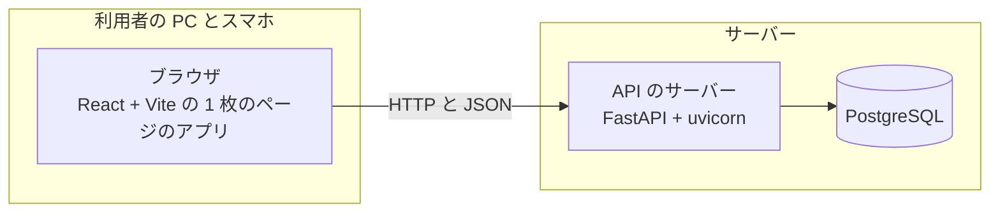

# 方式設計

## 構成

業務アプリは、ブラウザで動く 1 枚のページのアプリと、API のサーバーと、データベースの 3 つの部品で作る。

### 技術の選定

技術は依頼側が決めたものに従う(Issue #38 の方針決めの質問「技術をどう決めるか」(Q-03)の答え)。

- API のサーバー:
  - 言語は Python 3.12 である。
  - Web の枠組みは FastAPI で、uvicorn で動かす。
  - DB との対応づけは SQLAlchemy 2 で、スキーマの移行は Alembic で行う。
- データベース:
  - 本番は Azure Database for PostgreSQL である。
  - テストは WSL2 の PostgreSQL を一時に立てて使う。
- 画面:
  - 言語は TypeScript である。
  - 枠組みは React で、Vite で組む 1 枚のページのアプリである。
  - 部品は shadcn/ui(Radix)と Tailwind v4 で、表は TanStack Table で作る。
  - API の型は、FastAPI の OpenAPI から生成する。
- 型の検査: Python は pyright(strict)、TypeScript は tsc である。
- lint と整形: Python は Ruff、TypeScript は Oxlint である。
- テスト:
  - API のサーバーは pytest である。
  - 画面の部品は vitest である。
  - 画面の通しは Playwright である。
- 道具と依存:
  - 道具の版は mise でそろえる。
  - Python の依存は uv で、画面の依存は pnpm で管理する。

### 版

| 道具 | 版 | 入れ方 |
|---|---|---|
| Python | 3.12 | mise |
| Node.js | 24.21.0 | mise |
| uv | 0.13.6 | mise |
| pnpm | 12.16.1 | mise |
| PostgreSQL | 18 | WSL2 の Ubuntu 26.04 の apt。本番も同じ大版にそろえる(仮定。「リスクと技術的負債」の節) |

- 道具の版は、リポジトリの `mise.toml` に書いて固定する。
- ライブラリの版は、uv と pnpm のロックファイルで固定する。大版は「技術の選定」の節のとおりである(SQLAlchemy 2・Tailwind v4)。
- Python も `mise.toml` で 3.12 を指す。mise の Python は、人が自分の端末で `mise install` して入れる。
- jig gate のテストは、Ubuntu の Python(3.14)で走る。jig がテストの包みの中で使う Python を固定しており、版を指せないためである。
  - このため、[backend/pyproject.toml](../../backend/pyproject.toml) の Python の版は「3.12 以上」にし、上限を置かない。
  - 3.12 で動くことは、検査で確かめる。Ruff は 3.12 を対象にし、pyright も 3.12 として型を検査する。

### 置き場

- `backend/`: API のサーバー。`app/`(本体)・`alembic/`(移行)・`tests/`(pytest)を置く。
- `frontend/`: 画面。`src/`(本体)・`e2e/`(Playwright)を置く。
- 開発の時は、Vite の開発サーバーが `/api` を API のサーバーへ中継する。画面と API は同じ配信元に見える。
- 本番の配信の形は、本番に配置する Issue で決める。

### 動かし方

- API のサーバーは、`backend/` で `uvicorn app.main:create_app --factory` として起動する。
- 入口は `create_app(settings, clock, password_hasher)` である([backend/app/main.py](../../backend/app/main.py))。
  - 3 つの引数は、渡さなければ既定のものを組む。
  - 既定の設定は、環境変数から `load_settings` で読む。
  - 既定の時計は本物の時計である。
  - 既定の照合の役は、argon2-cffi の既定の強さの argon2id である。
  - テストは、時計と設定を渡して差し替える。
- API の型は、次の 2 つの手順で作る。API を変えたら、2 つとも作り直してリポジトリに入れる。
  1. `backend/` で `.venv/bin/python -m app.export_openapi > ../frontend/openapi.json` を流す。OpenAPI の JSON を書き出す([backend/app/export_openapi.py](../../backend/app/export_openapi.py))。DB には繋がない。
  2. `frontend/` で `pnpm exec openapi-typescript openapi.json -o src/api/schema.d.ts` を流す。画面の型を生成する。
- 画面の通しのテストは、起動の役([frontend/e2e/support/](../../frontend/e2e/support/))が要る一式を立てる。
  - Playwright の globalSetup が、全体の前に起動の役を呼ぶ。
  - 起動の役は、一時ディレクトリに PostgreSQL 18 を立て、移行と初期データのコマンドを流す。
  - 初期データのパスワードは、起動のたびに作る乱数である。
  - API のサーバーと Vite の画面のサーバーは、空いている口で立てる。
  - 画面の配信元とパスワードは、環境変数でテストに渡す。
  - テストが終わると、一式を止めて一時ディレクトリを消す。

## 横断の方式

- 認証と認可: 認証はログインの状態を DB に持つ方式で行う。認可はログイン中の利用者の役割で判定する。詳しくは「認証と認可の方式」の節に書く。
- トランザクション: API の要求 1 つを 1 つのトランザクションにする。
  - 応答を返せば確定し、想定しない例外なら取り消す。
  - 401 などの想定した誤りは、例外にせず応答として返す。このため、誤りの応答の前の書き込みも確定する。
  - 例: ログインの失敗の誤った回数の加算と、期限切れのログインの状態の削除は、確定してから 401 を返す。
- 排他: ログインでは、利用者の行を `SELECT … FOR UPDATE` で押さえてから誤った回数を数える。同時のログインで回数を数え落とさないためである。選ばなかった案は、plan.md の決定「誤った回数の排他」(D-08)に書く。
- 例外とログ:
  - API の誤りは、HTTP の状態と `{"detail": "<文>"}` の JSON で返す。
  - 本文の形の誤り(欄の欠け・型の違い・JSON として読めない本文)は、422 と文「入力の形が正しくありません」で返す。
  - 形の誤りでは、送った値を応答にもログにも出さない。OpenAPI の 422 も、`{"detail": "<文>"}` の形にする。
  - 想定しない例外は 500 と共通の文「時間をおいてもう一度試してください」で返す。文は画面共通規則の「メッセージの出し方」に合わせる。
  - 例外の中身(文と経路)は、ロガー `app.errors` のログにだけ残す。
  - ログは標準出力に出す。ログインの成否と社員番号は残し、パスワードとログインの状態の印は残さない。
  - 社員番号が数字 6 桁の形でなければ、値を出さずに「形の誤り」とだけ書く。社員番号の欄にパスワードを入れて呼ばれても、ログに残さないためである。
  - DB の接続は、SQL に渡した値を例外の文に載せない(`hide_parameters`)。API・初期データのコマンド・移行の 3 つの接続がこれに従う。
  - PostgreSQL が例外の文に付ける DETAIL(一意のキーや違反した行の中身)は、隠す対象の外とする。今の初期データと移行が入れるのは決まった値だけで、害が小さいためである。利用者が入れた値を書く移行やコマンドを足すときに見直す。
- 設定: 設定は環境変数から読む。読み方は [backend/app/settings.py](../../backend/app/settings.py) にまとめる。手元では `backend/.env` に書き、このファイルはリポジトリに入れない。詳しくは「設定」の節に書く。
- 日付とタイムゾーン: DB は `timestamptz` で UTC の時刻を持つ。API は ISO 8601 の時差つきの文字列で返す。画面は日本時間で出す。

### 認証と認可の方式

ログインの状態は DB に持ち、ブラウザにはその印だけをクッキーで渡す。署名つきのトークン(JWT)は選ばなかった。理由は plan.md の決定「ログインの状態の持ち方」(D-01)に書く。

- ログイン([FR-001](../requirements/functions/FNC-001.md#FR-001)・[FR-010](../requirements/functions/FNC-001.md#FR-010)):
  - 社員番号で利用者を引き、パスワードのハッシュを argon2id で照らす。
  - 照合に通ったハッシュが今の強さより弱ければ、今の強さで作り直す。
  - argon2id の強さは、argon2-cffi の既定の値(RFC 9106 の低メモリの推奨。メモリ 64MiB・回数 3・並列 4)にする。1 回の照合の時間は実装で測る。
  - ログインの状態の表は、印ごとに 1 行を持つ。同じ利用者の行を複数持てる([FR-022](../requirements/functions/FNC-001.md#FR-022))。
  - ログインのたびに、表の中の期限切れの行をまとめて消す。
  - 成功したら、32 バイトの乱数の印を作り、ログインの状態の表に入れる。
  - 表に入れるのは、印そのものではなく、鍵つきのハッシュ(HMAC-SHA256)である。鍵は設定 `SESSION_SECRET` である。
  - ハッシュは 16 進の 64 文字で持つ。
  - 印はクッキー `session` で返す。属性は HttpOnly・SameSite=Lax・Path=/ で、本番では Secure も付ける。
- 失敗の扱い([FR-002](../requirements/functions/FNC-001.md#FR-002)・[FR-003](../requirements/functions/FNC-001.md#FR-003)・[FR-023](../requirements/functions/FNC-003.md#FR-023)):
  - 次のどれも、401 と同じ文「社員番号かパスワードが違います」で返す。
  - 登録のない社員番号・数字 6 桁でない社員番号・誤ったパスワード・ロック中・役割なし。
  - 正しい形の社員番号は、ASCII の数字 6 桁だけである。全角の数字と前後の空白は、形の誤りとする。
  - どの失敗でも、argon2id の照合を 1 回だけ行ってから返す。応答の時間で登録の有無を推し量れないようにするためである。
  - 登録のない社員番号・数字 6 桁でない社員番号・ロック中は、ダミーのハッシュと照らす。ダミーのハッシュは同じ強さの値で作る。
  - 役割なしの判定は、照合の後に行う。
  - 形の誤りは、誤った回数に数えない。利用者を引く前に失敗とするためである。
  - 役割なしの利用者が正しいパスワードを入れたときは、誤った回数を変えない。
- ロック([FR-003](../requirements/functions/FNC-001.md#FR-003)・[FR-004](../requirements/functions/FNC-001.md#FR-004)・[FR-020](../requirements/functions/FNC-001.md#FR-020)):
  - 誤った回数とロックの終わる時刻は、利用者の表の列に持つ。
  - 5 回目の誤りで、ロックの終わる時刻を今から 30 分後にする。ロックの時間は、業務の層の定数 `LOCK_DURATION` の 1 か所で決める。
  - ロックの終わる時刻は、ロックしたときに列へ保存する。ロックの時間を変えても、保存済みの終わる時刻は変えない。
  - ロック中の試みは、ダミーのハッシュと照らしてから失敗とし、列を変えない。
  - ロックの終わる時刻になれば、ログインできる。終わる時刻ちょうどの試みも受ける。
  - ロックの終わる時刻以後の最初の試みで、回数を 0 に戻してから数える。成功したときも 0 に戻す。
- ログインの状態の確かめ([FR-005](../requirements/functions/FNC-001.md#FR-005)・[FR-006](../requirements/functions/FNC-001.md#FR-006)・[FR-008](../requirements/functions/FNC-001.md#FR-008)):
  - ログインの要る API は、クッキーの印のハッシュで表を引く。
  - 次のどれかなら、その行を消して 401 を返す。最後の操作から 30 分を超えた。ログインから 8 時間を超えた。
  - ちょうど 30 分とちょうど 8 時間は、まだ有効である。
  - 有効なら、最後の操作の時刻を今にする。
- ログアウト([FR-013](../requirements/functions/FNC-002.md#FR-013)): その印の行を消し、クッキーを消す。行がなくても 204 を返す。
- 認可([FR-018](../requirements/functions/FNC-003.md#FR-018)): メニューを返す API は、利用者の役割の項目だけを組み立てる。役割を持たない項目は、画面に送らない。
- 認可(後の Issue):
  - 業務の API は、共通の依存(FastAPI の Depends)を付けて守る。
  - 共通の依存は、項目表の「項目 → 許す役割」で判定する。
  - 共通の依存は、最初の業務の API を作る Issue で作る。
- 要求の偽造(CSRF)への備え:
  - クッキーは SameSite=Lax にする。
  - 状態を変える API(ログイン・ログアウト)は、`Content-Type: application/json` の要求だけを受ける。ほかの形は 415 で断る。
  - 他のサイトのフォームからは、この形の要求を送れない。

### API

| 口 | 要るログイン | 返すもの | 要件 |
|---|---|---|---|
| `POST /api/auth/login` | なし | 200 と利用者(`GET /api/me` と同じ形)。失敗は 401 | ログイン・失敗・ロック(FR-001〜FR-004・FR-020・FR-023) |
| `POST /api/auth/logout` | なし | 204 | ログアウト(FR-012・FR-013) |
| `GET /api/me` | 要る | 社員番号・氏名・部署・役割の一覧 | ログイン中の利用者(FR-009・FR-014) |
| `GET /api/menu` | 要る | 役割ごとの項目の一覧。項目は名前と「使えるか」を持つ | メニュー(FR-015〜FR-019) |

- API の型は FastAPI の OpenAPI から画面の型を生成する。手順は「動かし方」の節に書く。
- ログインの要る口は、ログインしていなければ 401 と文「ログインしてください」を返す([FR-008](../requirements/functions/FNC-001.md#FR-008))。
- メニューの応答の形は `{"groups":[{"role":{"code","name"},"items":[{"code","name","available"}]}]}` である。
  - 役割ごとのまとまり(`groups`)を、役割の順に並べる。
  - `available` が偽の項目は、準備中である。

### メニューの項目の持ち方

- 項目表([FR-016](../requirements/functions/FNC-003.md#FR-016))は、API のサーバーのコードの定数に持つ。DB の表にはしない。理由は plan.md の決定「メニューの項目表の持ち方」(D-03)に書く。
- 項目は、項目コード・名前・役割・並び順・使えるかを持つ。この Issue では、すべての項目が「使えない」(準備中)である。
- 項目コードは英語の名前である(例 `item_search` 品目の検索)。
- 役割の並びは、項目表の定数に書いた順である。
- 業務の画面を足す Issue で、その項目を「使える」にして行き先を足す。
- 使える項目の行き先は、仮に `/<項目コード>` とする。業務の画面を足す Issue で決め直す。

### テーブル

すべてのテーブルと列に、日本語の論理名のコメントを付ける([NFR-011](../requirements/nfr.md#NFR-011))。

- テーブルのコメントは「T001 部署」のように、テーブル番号と論理名を半角の空白でつなぐ。
- テーブル番号は T001 から作った順に振り、消しても使い回さない。
- 列のコメントは論理名だけを書く。
- Alembic が作る `alembic_version` は道具の表なので、コメントの検査から外す。

| 番号 | 論理名 | 物理名 | 列(物理名 論理名) |
|---|---|---|---|
| T001 | 部署 | `departments` | `id` 部署 ID・`name` 部署名(一意) |
| T002 | 役割 | `roles` | `code` 役割コード(主キー)・`name` 役割名・`sort_order` 並び順 |
| T003 | 利用者 | `users` | 下の箇条書き |
| T004 | 利用者の役割 | `user_roles` | `user_id` 利用者 ID・`role_code` 役割コード。2 つで主キー |
| T005 | ログインの状態 | `sessions` | 下の箇条書き |

利用者(T003)の列:

- `id` 利用者 ID
- `employee_no` 社員番号(一意。数字 6 桁を検査の制約で守る)
- `name` 氏名
- `department_id` 部署 ID(部署の外部キー)
- `password_hash` パスワードのハッシュ
- `failed_login_count` 誤った回数(既定 0)
- `locked_until` ロックの終わる時刻(ロックしていなければ空)
- `created_at` 作った時刻・`updated_at` 直した時刻

ログインの状態(T005)の列:

- `token_hash` 印のハッシュ(主キー。HMAC-SHA256 の 16 進の 64 文字)
- `user_id` 利用者 ID(利用者の外部キー。利用者を消すと一緒に消える)
- `created_at` ログインした時刻
- `last_seen_at` 最後の操作の時刻

役割コードは `employee`(社員)・`manager`(上長)・`buyer`(購買担当)・`admin`(管理者)である。

### 初期データ

- 部署と役割は、Alembic の移行で入れる。秘密を含まないためである。
  - 部署: 総務部・営業部・製造部
  - 役割: 社員・上長・購買担当・管理者
- 4 利用者は、初期データを入れるコマンドで入れる。パスワードを環境変数から読むためである([NFR-006](../requirements/nfr.md#NFR-006))。
- コマンドは何度流しても同じ結果になる。社員番号が同じ利用者は作り直さず、氏名・部署・役割・パスワードを合わせる。
  - 今のハッシュがそのパスワードのもので、今の強さなら、ハッシュを作り直さない。
  - 誤った回数とロックの終わる時刻は変えない。

| 社員番号 | 氏名 | 部署 | 役割 | パスワードの環境変数 |
|---|---|---|---|---|
| 000001 | 社員 一郎 | 営業部 | 社員 | `SEED_PASSWORD_EMPLOYEE` |
| 000002 | 上長 二郎 | 営業部 | 社員・上長 | `SEED_PASSWORD_MANAGER` |
| 000003 | 購買 三子 | 総務部 | 購買担当 | `SEED_PASSWORD_BUYER` |
| 000004 | 管理 四郎 | 総務部 | 管理者 | `SEED_PASSWORD_ADMIN` |

### 戻し方

- 移行は `alembic downgrade base` で、この Issue の 5 つのテーブルを消して戻せる。
- この Issue の前に DB の中身はないので、戻して失うデータは初期データだけである。

### 設定

| 環境変数 | 中身 | 無いとき |
|---|---|---|
| `DATABASE_URL` | DB の接続先 | API のサーバーは起動の時に止まる |
| `SESSION_SECRET` | ログインの状態の印をハッシュにする鍵(32 バイト以上) | API のサーバーは起動の時に止まる |
| `COOKIE_SECURE` | クッキーに Secure を付けるか | 付ける(本番の既定) |
| `SEED_PASSWORD_*` | 初期データの 4 利用者のパスワード | 初期データを入れるコマンドだけが止まる |

- 設定は pydantic-settings で読む。
  - API のサーバーの設定は `AppSettings` で、起動の時に `load_settings` で読む。
  - 欠けているか正しくなければ、`SettingsError` で止まる。文には環境変数の名前だけを出し、値は出さない。
  - 移行のコマンドは、`DATABASE_URL` だけを読む。初期データのコマンドは、`DATABASE_URL` と `SEED_PASSWORD_*` を読む。
- リポジトリには、名前だけを書いた `backend/.env.example` を置く。値は書かない。

## 層と依存

- 層(API のサーバー): 上から次の 3 つである。
  - 口: FastAPI のルーター。
  - 業務: ログインとメニューの処理。
  - データ: SQLAlchemy のモデルと問い合わせ。
- 層(画面): ページ → API の呼び出し(生成した型)。
- 許す依存: 上の層から下の層だけ。
- 禁じる依存: 下の層から上の層。業務の層は FastAPI の型に頼らない。
- 差し替えの口: 設定・時計・パスワードの照合の役は、`create_app` の引数で差し替える。テストは時計を進めて、ログインの状態の 30 分と 8 時間、ロックの時間を確かめる。ロックのテストは、ロックの時間を書き写さずに業務の層の定数 `LOCK_DURATION` を読む。

## 品質目標と非機能要件への対応

- [NFR-001](../requirements/nfr.md#NFR-001): ログインとメニューは DB を数回引くだけにする。画面の通しのテストで時間を測る。
- [NFR-002](../requirements/nfr.md#NFR-002): 利用者約 120 人・部署 3 つでの行の数を次のとおり見積もる。どの表も小さく、索引は主キーと一意の制約だけで足りる。
  - 部署(T001)は 3 行、役割(T002)は 4 行、利用者(T003)は約 120 行である。
  - 利用者の役割(T004)は、1 人が多くて 4 つの役割を持つので、多くて 480 行である。
  - ログインの状態(T005)は、ログインのたびに期限切れの行を消すので、残るのは 8 時間のうちに作った行だけである。
  - 1 人が 8 時間に 10 回ログインすると仮定して、多くて約 1,200 行である。
- [NFR-003](../requirements/nfr.md#NFR-003): 「初期データ」の節のとおり、移行と初期データのコマンドだけで入れる。空の DB に入れて 4 利用者がログインできることを、API のテストで確かめる。
- [NFR-004](../requirements/nfr.md#NFR-004)・[NFR-005](../requirements/nfr.md#NFR-005): 自前の照合と argon2id のハッシュで満たす。
- [NFR-006](../requirements/nfr.md#NFR-006)・[NFR-007](../requirements/nfr.md#NFR-007): 「設定」の節のとおり。起動の時に設定を読み、欠けていれば止まる。
- [NFR-008](../requirements/nfr.md#NFR-008): 「認証と認可の方式」のログインの状態の確かめ。
- [NFR-009](../requirements/nfr.md#NFR-009): 仕上げと検証で、gitleaks でリポジトリの履歴を走査する。jig のテストの手順には実行器しか書けないので、手順には入れない。
- [NFR-010](../requirements/nfr.md#NFR-010): 画面共通規則と、幅 375px の画面の通しのテスト。
- [NFR-011](../requirements/nfr.md#NFR-011): 「テーブル」の節の規則と、DB のカタログを引くテスト。

## リスクと技術的負債

- 期限の切れたログインの状態の行は、引いた時とログインの時に消す。誰もログインしない間は行が残る。定期の掃除は夜間の処理の Issue で足す。
- PostgreSQL 18 が本番の Azure Database for PostgreSQL で使えるかは、まだ確かめていない。本番に配置する Issue で確かめ、使えなければ大版を下げる。
- 本番の配信の形(画面と API を同じ配信元にするか)は決めていない。違う配信元にするなら、クッキーと CSRF の備えを見直す。
