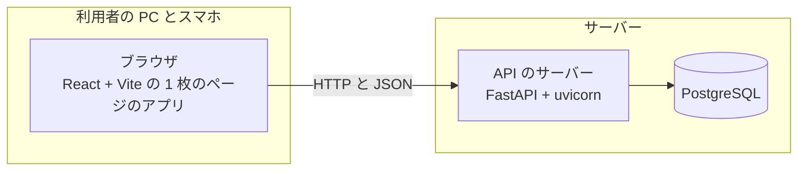

# 方式設計

## 構成

業務アプリは、ブラウザで動く 1 枚のページのアプリと、API のサーバーと、データベースの 3 つの部品で作る。

### 技術の選定

技術は依頼側が決めたものに従う(Issue #38 の方針決めの Q-03 の答え)。

- API のサーバー:
  - 言語は Python 3.12 である。
  - Web の枠組みは FastAPI で、uvicorn で動かす。
  - DB との対応づけは SQLAlchemy 2 で、スキーマの移行は Alembic で行う。
- データベース:
  - 本番は Azure Database for PostgreSQL である。
  - テストは WSL2 の PostgreSQL を一時に立てて使う。
- 画面:
  - 言語は TypeScript である。
  - 枠組みは React で、Vite で組む 1 枚のページのアプリである。
  - 部品は shadcn/ui(Radix)と Tailwind v4 で、表は TanStack Table で作る。
  - API の型は、FastAPI の OpenAPI から生成する。
- 型の検査: Python は pyright(strict)、TypeScript は tsc である。
- lint と整形: Python は Ruff、TypeScript は Oxlint である。
- テスト:
  - API のサーバーは pytest である。
  - 画面の部品は vitest である。
  - 画面の通しは Playwright である。
- 道具と依存:
  - 道具の版は mise でそろえる。
  - Python の依存は uv で、画面の依存は pnpm で管理する。

### 版

| 道具 | 版 | 入れ方 |
|---|---|---|
| Python | 3.12 | 手元の Python 3.12 を使う |
| Node.js | 24.21.0 | mise |
| uv | 0.13.6 | mise |
| pnpm | 12.16.1 | mise |
| PostgreSQL | 18 | WSL2 の Ubuntu 26.04 の apt。本番も同じ大版にそろえる |

- 道具の版は、リポジトリの `mise.toml` に書いて固定する。
- ライブラリの版は、uv と pnpm のロックファイルで固定する。大版は「技術の選定」の節のとおりである(SQLAlchemy 2・Tailwind v4)。
- Python を mise で固定するか、手元の Python を指すかは、Issue #38 の設計で決める。

## 横断の方式

- 認証と認可: 利用者の ID とパスワードをシステムの中で持ち、パスワードはハッシュだけを保存する。外部の認証には頼らない。認可は利用者の役割で判定する。具体の方式は Issue #38 の設計で書く。
- トランザクション: Issue #38 の設計で書く。
- 排他: Issue #38 の設計で書く。
- 例外とログ: Issue #38 の設計で書く。
- 設定: Issue #38 の設計で書く。秘密の情報はリポジトリに入れない。
- 日付とタイムゾーン: Issue #38 の設計で書く。
